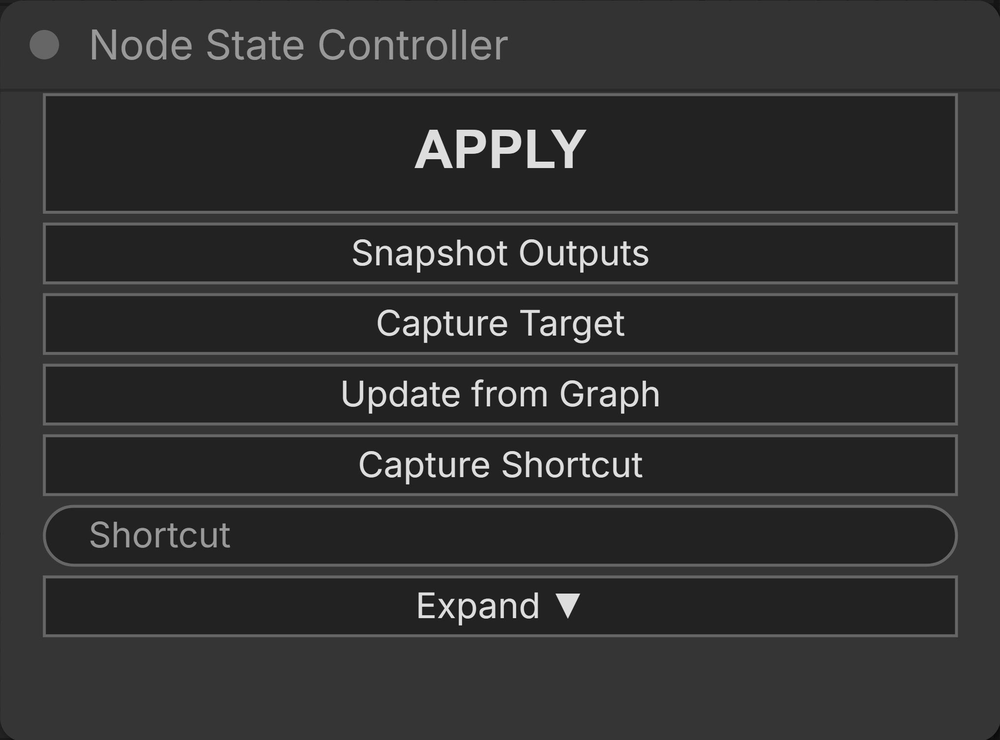
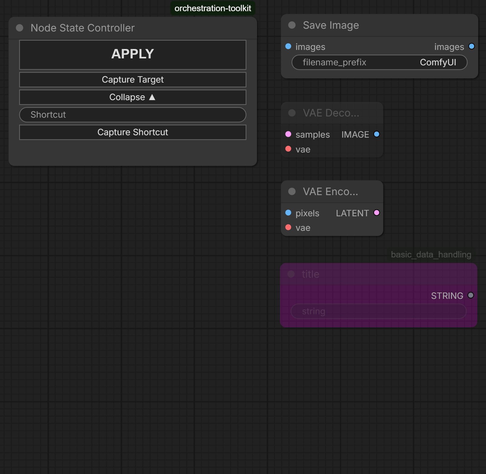
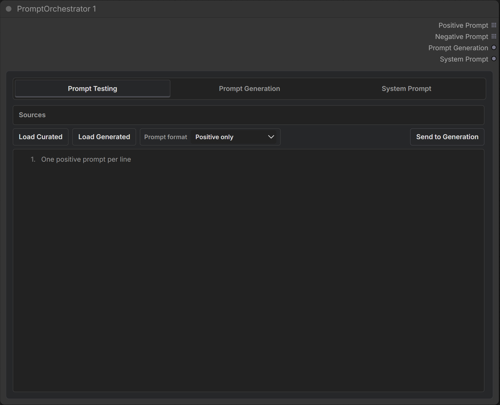
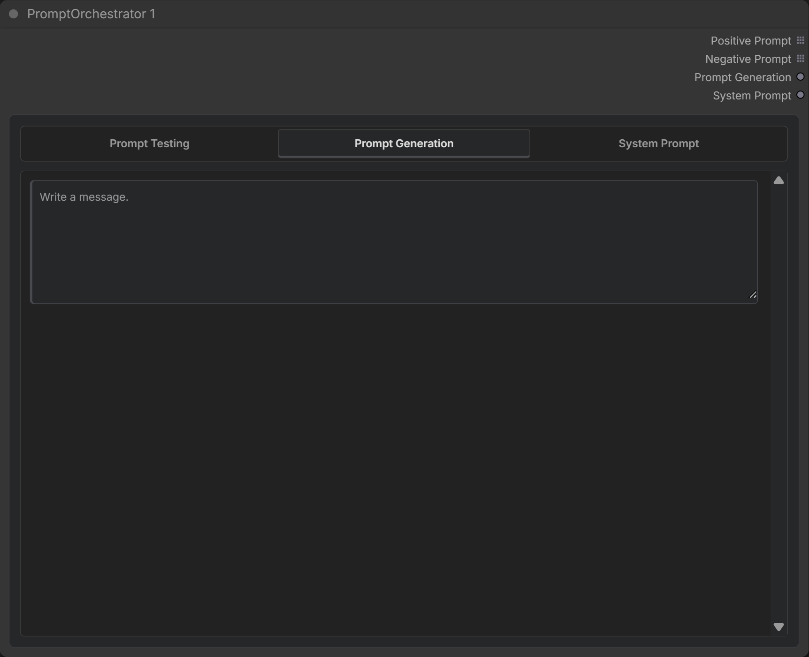
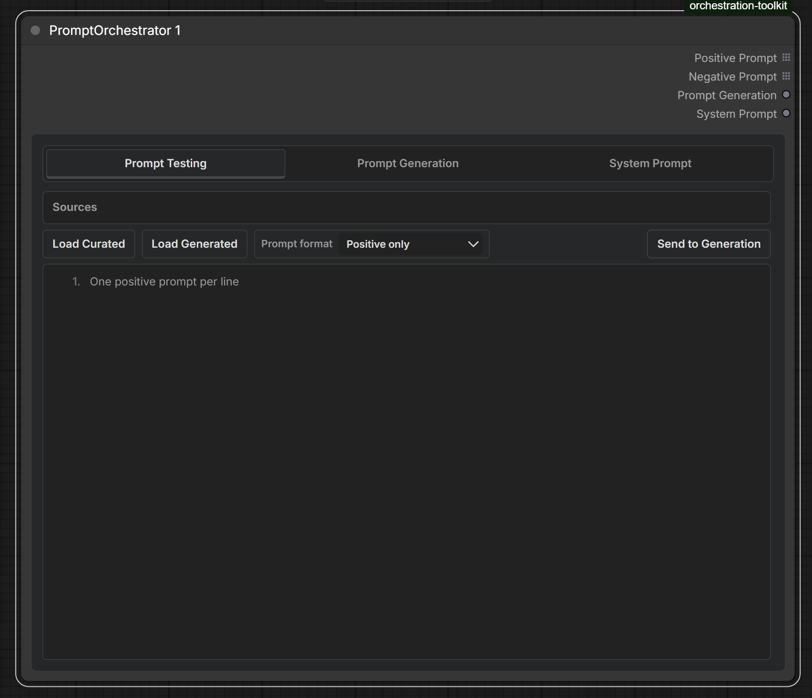
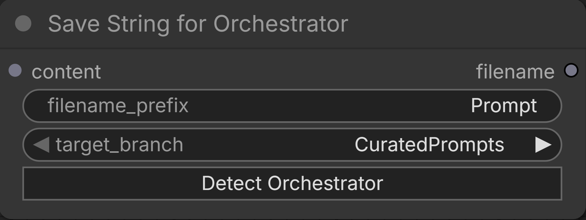
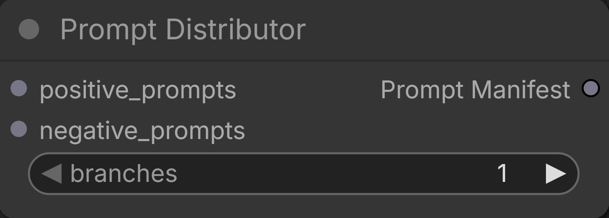
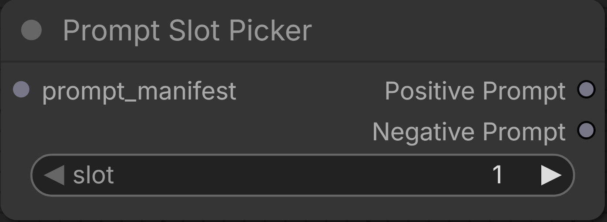
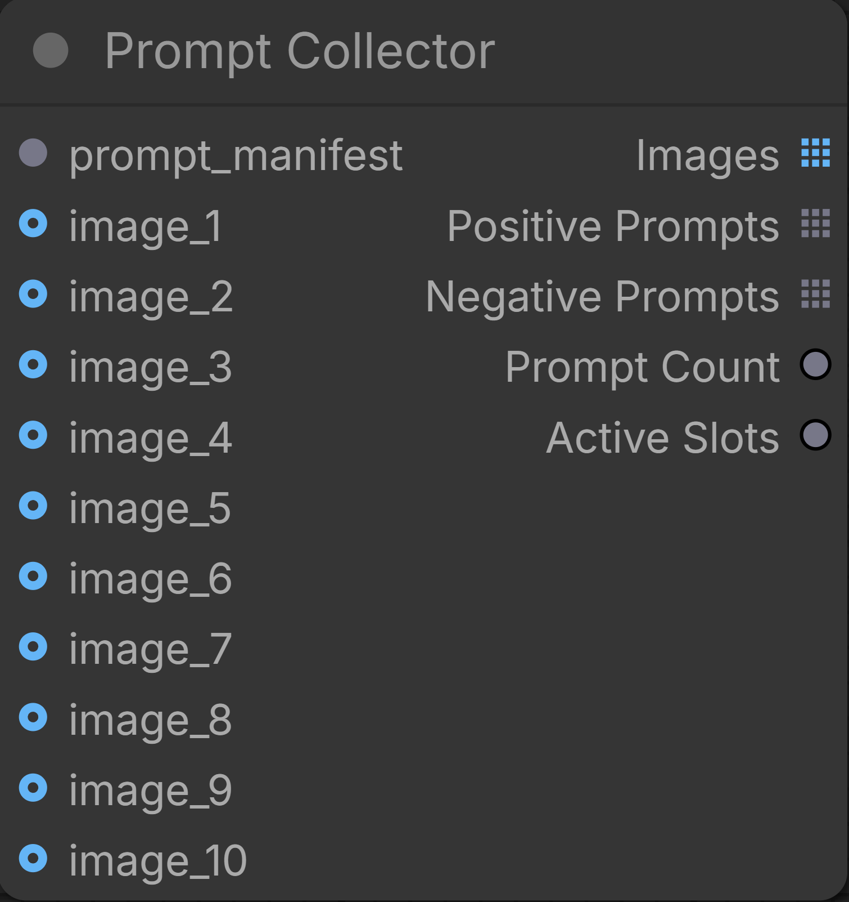
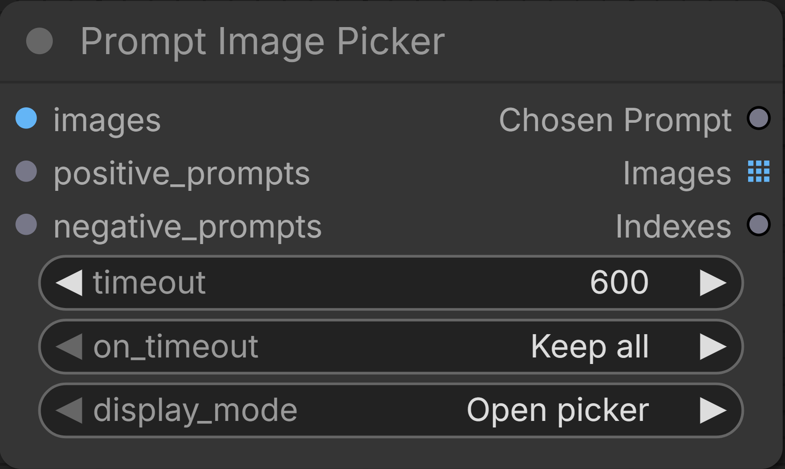

# ComfyUI Orchestration Toolkit

A ComfyUI custom-node pack for controlling node states and making prompt generation and testing faster without repeatedly copying prompts between nodes or interfaces.

**Main benefits:**

- Control the state of any number of nodes and switch entire branches with one click by controlling their output nodes.
- Test complete prompt lists sequentially.
- Route up to ten prompts through independent parallel branches, for example different APIs, to speed up generation.
- Work with positive-only or positive-and-negative prompt lists.
- Keep prompt generation, testing, selection, saving, and reuse of selected prompts connected in one process.

## Nodes

### Node State Controller

Control the state of multiple workflow nodes from one place. Capture target nodes one by one or take a whole selection at once, snapshot every output node, update all targets from the current graph, and apply them together with one click or an optional keyboard shortcut.

| Interface | Definition |
| --- | --- |
| Inputs | None |
| Outputs | None |

How to use

Available actions are Mute, Unmute, Bypass, and Unbypass. A captured node keeps the
action that matches its state at capture time, so you can set your graph up the way you
want it and record that.

A new controller starts collapsed. Press <code>Expand ▼</code> below the buttons to show
its targets and <code>Collapse ▲</code> to hide them again.

**Capture one node at a time**

1. Press <code>Capture Target</code> with nothing or only a single node selected.
2. Click the nodes you want to control.
3. Press the capture button again to stop capturing targets.

**Capture a whole selection**

Select several nodes, then press <code>Capture Target</code> once. All of them are added
immediately and no click mode starts.

**Snapshot the branches**

Press <code>Snapshot Outputs</code> to capture every output node of the graph with its
current state. ComfyUI executes backwards from its output nodes, so these alone decide
which branch runs — one controller per variant is enough to switch between them.

<code>Snapshot Outputs</code> only adds output nodes that are not in the list yet. Rows
that are already there keep their action, and so does a node you capture again — manual
edits survive.

**Update from the graph**

Set the nodes in your graph the way you want them, then press
<code>Update from Graph</code>. Every row takes the current state of its node. A short
message tells you how many rows changed and whether a target was not found.
<kbd>Ctrl</kbd>+<kbd>Z</kbd> undoes the update.

**Copying**

A copied controller controls the same nodes as the original. Copies of target nodes
within the same workflow start fresh: no existing controller controls them until you
capture them. Copy nodes together with their controller into another workflow and they
keep working together.

**Working with long lists**

Above ten targets the list is shown one page at a time, with a header and Prev/Next
buttons. <code>APPLY</code> always acts on every target, not only on the visible page.

Press <code>APPLY</code> or use the configured keyboard shortcut to change all target
states.

### PromptOrchestrator

Brings prompt generation and prompt testing into one central node. Together with the companion nodes, it connects the complete prompt process without manual copy-pasting between nodes or other interfaces.

- Test prompt lists sequentially.
- Route prompts through Prompt Distributor and Prompt Slot Pickers to up to ten independent branches, for example API branches, to speed up generation.
- Use positive-only or positive-and-negative prompt lists.
- Use PromptOrchestrator as the central interface for selecting, saving, and reusing prompts with Prompt Image Picker and Save String for Orchestrator.

| Interface | Definition |
| --- | --- |
| Inputs | <code>curated_prompts_folder</code> (<code>STRING</code>), <code>generated_prompts_folder</code> (<code>STRING</code>), <code>multi_prompt_testing_editor</code> (<code>STRING</code>), <code>prompt_generation_editor</code> (<code>STRING</code>), <code>use_prompt_generation_branch</code> (<code>BOOLEAN</code>), <code>system_prompt</code> (<code>STRING</code>), <code>prompt_testing_format</code> (<code>COMBO</code>: <code>Positive only</code> or <code>Positive + Negative</code>) |
| Outputs | <code>Positive Prompt</code> (<code>STRING</code> list), <code>Negative Prompt</code> (<code>STRING</code> list), <code>Prompt Generation</code> (<code>STRING</code>), <code>System Prompt</code> (<code>STRING</code>) |

Prompt formats, outputs, and PromptStorage

Choose between <code>Positive only</code> and <code>Positive + Negative</code>. Positive-only mode treats every non-empty line as one prompt. Positive-and-negative mode reads the fixed ordered pairs <code>P1=...;N1=...</code>, <code>P2=...;N2=...</code>, and so on.

The active <code>Prompt Testing</code> or <code>Prompt Generation</code> tab determines which prompt output is used. The System Prompt output remains available in both modes.

PromptStorage gives one PromptOrchestrator its own <code>CuratedPrompts</code> and <code>GeneratedPrompts</code> folders. Open <code>Prompt Testing → Sources</code> and press <code>Prompt Storage</code> once to create it and fill the source paths automatically. This storage is needed to load, save, and reuse prompts safely with Save String for Orchestrator.

### Save String for Orchestrator

Saves the prompts selected in Prompt Image Picker into the PromptStorage of its connected PromptOrchestrator, so they can be reused in PromptOrchestrator later without manual copy-pasting.

| Interface | Definition |
| --- | --- |
| Inputs | <code>content</code> (<code>STRING</code>), <code>filename_prefix</code> (<code>STRING</code>), <code>target_branch</code> (<code>COMBO</code>: <code>CuratedPrompts</code> or <code>GeneratedPrompts</code>) |
| Output | <code>filename</code> (<code>STRING</code>) |

How to use

1. Create PromptStorage from the matching PromptOrchestrator.
2. Connect <code>Chosen Prompt</code> from Prompt Image Picker, or another string path originating from that PromptOrchestrator, to <code>content</code>.
3. Press <code>Detect Orchestrator</code> to connect this Save String node to the corresponding PromptOrchestrator.
4. Choose <code>CuratedPrompts</code> or <code>GeneratedPrompts</code> and set the filename prefix.

PromptStorage contains user data inside the installed node pack. Deleting, replacing, or uninstalling that directory can remove stored prompts. If a loaded workflow references missing storage, open <code>Prompt Testing → Sources</code> and press <code>Prompt Storage</code> to create an empty replacement. This restores operation but cannot restore the previous prompts.

### Prompt Distributor

Starts the optional parallel prompt-testing pipeline. It takes the prompt list from PromptOrchestrator and works with Prompt Slot Pickers to forward individual prompts to separate branches, for example branches using different APIs.

| Interface | Definition |
| --- | --- |
| Inputs | <code>positive_prompts</code> (<code>STRING</code> list), <code>negative_prompts</code> (<code>STRING</code> list), <code>branches</code> (<code>INT</code>, 1 to 10) |
| Output | <code>Prompt Manifest</code> (<code>ORCHESTRATION_PROMPT_MANIFEST</code>) |

How to use

Connect the positive and negative prompt lists from PromptOrchestrator, choose how many parallel branches should be active, and connect the Prompt Manifest to the Prompt Slot Pickers.

If the list contains more prompts than configured branches, only the prompts that fit are distributed and the remaining prompts are reported in the log.

### Prompt Slot Picker

Place one Prompt Slot Picker in each parallel branch. Its slot number chooses which line from the Distributor prompt list is forwarded to the next node.

| Interface | Definition |
| --- | --- |
| Inputs | <code>prompt_manifest</code> (<code>ORCHESTRATION_PROMPT_MANIFEST</code>), <code>slot</code> (<code>INT</code>, 1 to 10) |
| Outputs | <code>Positive Prompt</code> (<code>STRING</code>), <code>Negative Prompt</code> (<code>STRING</code>) |

How slots work

Slot 1 forwards the first prompt, Slot 2 the second prompt, and so on. Assign a different slot to each parallel branch. If the selected slot has no prompt, that branch does not run.

### Prompt Collector

Brings the generated images from all active parallel branches back together and returns them with their matching prompts in slot order for the next processing or review step.

| Interface | Definition |
| --- | --- |
| Inputs | <code>prompt_manifest</code> (<code>ORCHESTRATION_PROMPT_MANIFEST</code>), <code>image_1</code> to <code>image_10</code> (optional lazy <code>IMAGE</code> inputs) |
| Outputs | <code>Images</code> (<code>IMAGE</code> list), <code>Positive Prompts</code> (<code>STRING</code> list), <code>Negative Prompts</code> (<code>STRING</code> list), <code>Prompt Count</code> (<code>INT</code>), <code>Active Slots</code> (<code>STRING</code>) |

Collection behavior

Only active image inputs are requested. Each active slot must provide exactly one image; incomplete results are rejected instead of silently returned. Original image dimensions and prompt order are preserved.

### Prompt Image Picker

Provides the optional final review step after the Collector, or for any matching image and prompt lists. It pauses the workflow so you can select images, inspect them, edit their prompts, and forward only the selected images to the next node.

| Interface | Definition |
| --- | --- |
| Inputs | <code>images</code> (<code>IMAGE</code> list), <code>positive_prompts</code> (<code>STRING</code> list), <code>negative_prompts</code> (<code>STRING</code> list), <code>timeout</code> (<code>INT</code>, 1 to 86,400), <code>on_timeout</code> (<code>COMBO</code>: <code>Keep all</code> or <code>Cancel</code>), <code>display_mode</code> (<code>COMBO</code>: <code>Open picker</code> or <code>Compact notification</code>) |
| Outputs | <code>Chosen Prompt</code> (<code>STRING</code>), <code>Images</code> (<code>IMAGE</code> list), <code>Indexes</code> (<code>STRING</code>) |

Selection and timeout behavior

The three input lists must contain the same number of items, from one to ten. The gallery supports selection, prompt editing, zoom, and pan while returning the original image tensors unchanged.

A timeout can either keep all images with the latest valid prompt edits or cancel execution.

## Compatibility

- Python 3.10 or newer

## Installation

Clone the repository into the ComfyUI custom-nodes directory and restart ComfyUI:

~~~bash
cd ComfyUI/custom_nodes
git clone https://github.com/flows-and-frames/ComfyUI-Orchestration-Toolkit.git
~~~
